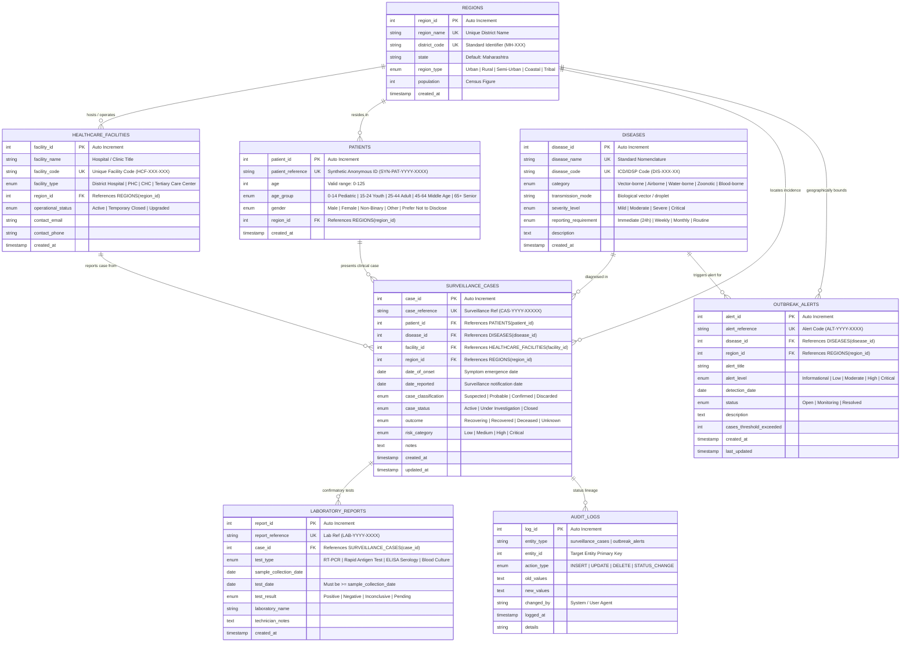

# ENTITY RELATIONSHIP (ER) & ENHANCED ER (EER) DOCUMENTATION
## Disease Surveillance and Epidemiology Database (DSED)

---

## 1. Executive Architecture Summary
The Disease Surveillance and Epidemiology Database models complex public health interactions between geographic jurisdictions, pathogen classifications, healthcare reporting infrastructure, de-identified patient cohorts, clinical incident tracking, laboratory diagnostic verification, and automated outbreak early-warning alerts.

---

## 2. Mermaid Entity-Relationship Diagram

---

## 3. Relational Schema Mapping & Cardinalities

| Relationship | Cardinality | Parent Entity | Child Entity | Foreign Key Column | Delete Rule | Update Rule | Business Rationale |
|---|---|---|---|---|---|---|---|
| Region to Facilities | 1 : N | `regions` | `healthcare_facilities` | `region_id` | RESTRICT | CASCADE | A facility must belong to a valid jurisdiction. |
| Region to Patients | 1 : N | `regions` | `patients` | `region_id` | RESTRICT | CASCADE | De-identified demographic cohort resides in a region. |
| Region to Cases | 1 : N | `regions` | `surveillance_cases` | `region_id` | RESTRICT | CASCADE | Incident location for regional epidemiological calculation. |
| Disease to Cases | 1 : N | `diseases` | `surveillance_cases` | `disease_id` | RESTRICT | CASCADE | Every case tracks a specific validated pathogen. |
| Patient to Cases | 1 : N | `patients` | `surveillance_cases` | `patient_id` | RESTRICT | CASCADE | A synthetic patient may present multiple surveillance episodes. |
| Facility to Cases | 1 : N | `healthcare_facilities` | `surveillance_cases` | `facility_id` | RESTRICT | CASCADE | Originating notification clinic or hospital. |
| Case to Lab Reports | 1 : N | `surveillance_cases` | `laboratory_reports` | `case_id` | RESTRICT | CASCADE | Multiple assays (RT-PCR, ELISA) can substantiate one case. |
| Disease & Region to Alerts | 1 : N | `diseases`, `regions` | `outbreak_alerts` | `disease_id`, `region_id` | RESTRICT | CASCADE | Alert triggers are localized by pathogen and territory. |

---

## 4. Enhanced Entity-Relationship (EER) Discussion

### 4.1 Specialization & Generalization Analysis
In public-health epidemiological systems, entities exhibit hierarchical attributes:

1. **Healthcare Facilities Hierarchy**:
   - General Superclass: `HEALTHCARE_FACILITIES`
   - Subclasses:
     - *Primary Level*: Primary Health Centre (PHC), Community Health Centre (CHC)
     - *Secondary Level*: Sub-District Hospital, District Hospital
     - *Tertiary Level*: Tertiary Care Medical College Hospital
   - In our normalized physical design, this is implemented as a single-table discriminator (`facility_type`) with specialized constraints to eliminate unnecessary join overhead while preserving semantic categorization.

2. **Temporal Clinical State Progression**:
   - Progression: `Suspected` -> `Probable` -> `Confirmed` (or `Discarded`)
   - Outcome States: `Active` (Recovering) -> `Closed` (`Recovered` vs `Deceased`)
   - The status transitions are governed by database integrity triggers (`trg_case_audit_update`), ensuring total participation and disjoint state transitions.

3. **De-identified Patient Cohort Generalization**:
   - To comply with academic ethics and health information privacy, patient identities generalize into de-identified cohorts using synthetic identifiers (`SYN-PAT-2026-XXXX`), age categories, and regional centroids rather than exposing PII.

---

## 5. Constraint Matrix
| Table Name | Constraint Name | Type | Definition / Expression |
|---|---|---|---|
| `regions` | `uq_region_name` | UNIQUE | `region_name` |
| `regions` | `uq_district_code` | UNIQUE | `district_code` |
| `diseases` | `uq_disease_name` | UNIQUE | `disease_name` |
| `diseases` | `uq_disease_code` | UNIQUE | `disease_code` |
| `healthcare_facilities` | `uq_facility_code` | UNIQUE | `facility_code` |
| `patients` | `uq_patient_ref` | UNIQUE | `patient_reference` |
| `patients` | `chk_patient_age` | CHECK | `age >= 0 AND age <= 125` |
| `surveillance_cases` | `uq_case_ref` | UNIQUE | `case_reference` |
| `surveillance_cases` | `chk_case_dates` | CHECK | `date_reported >= date_of_onset` |
| `laboratory_reports` | `uq_lab_ref` | UNIQUE | `report_reference` |
| `laboratory_reports` | `chk_lab_dates` | CHECK | `test_date >= sample_collection_date` |
| `outbreak_alerts` | `uq_alert_ref` | UNIQUE | `alert_reference` |
